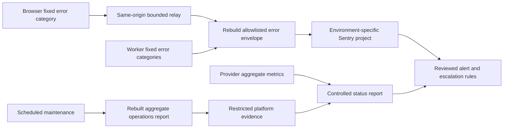

# Monitoring operations and incident response

更新日期：2026-11-01（實作／正式環境唯讀查核為 2026-10-31，最終本機驗收為 2026-11-01）。沿用 [Privacy-first observability](observability.md)，適用於既有 `epet-api`、隔離的 application staging 與各自的 Sentry projects。本文件是設定與演練 Runbook，不是正式監控已啟用、警報已送達或達成 SLO 的證明。不得為驗證監控而在 Production 建立測試會員／學生、故意破壞 D1 或觸發正式寄信。

## 架構與資料邊界



Browser 不持有真實 DSN；其 SDK envelope 在本機 transport 與 Worker relay 都重新建構。Worker 使用獨立 client／scope，透過 `waitUntil` 做有界 delivery。錯誤分類僅為固定 category、route group、method、可選 5xx status、environment／commit；禁止 user、tenant、workspace、class、student、request／session correlation ID。這不是 APM tracing 或使用者行為分析。

Cron 的 aggregate report 是另一個嚴格契約：schema version、固定 kind、environment／commit、分鐘時間桶、duration bucket、投影 checked／verified／mismatched／missing／repaired／truncated，以及 coverage／health。沒有學生總數、內容或 auth cleanup rows。Sentry error transport 不會轉送 report、log/check-in envelope；這些報表仍須透過受限平台查詢或另行審查的 collector 取得。不得把 console output 直接套入第三方 webhook。

## 啟用狀態的證據等級

| 層級 | 可以確認 | 不能推論 |
| --- | --- | --- |
| Source | repo 的 environment label、allowlist、timeouts、build flag wiring 與 Wrangler policy | 目前 serving Worker／assets 已部署此版 |
| Deployed metadata | 指定 account／Worker 的 secret **名稱**、GitHub environment variable 的允許 flag、deployed observability 設定、version | Secret 值正確、Sentry project privacy 設定、成功 delivery |
| Synthetic receipt | 隔離 staging 的固定 canary event 實際出現在正確 environment／project，欄位符合 allowlist | production delivery 或 alert notification 已成功 |
| Alert receipt | 經核准 staging drill 的 rule trigger、primary／backup receipt／ack 與 recovery | 未來每一次事件必送達，或已達成正式 SLO |

正式證據不足時填 `unknown`／`not_verified`；明確 missing／disabled 才填 `disabled`，無法解析或憑證／權限不足不等同未啟用。Worker secret name 存在仍可能是 invalid DSN，程式會 fail closed。`/api/v1/health` 不回傳監控設定，也不驗證 D1 或 Sentry；202 relay acceptance、Cloudflare invocation success、workflow success 都不是 provider receipt。

未取得的 Sentry privacy／alert／receipt 證據保持未驗證。不要下載或貼上真實 DSN、API token、Worker script 中的 secrets、raw events、完整 invocation logs 或 D1 rows 來補這張表。

### 2026-10-31 實際唯讀核對

| 證據 | 實際觀察 | 結論與限制 |
| --- | --- | --- |
| 公開 relay 的未登入 GET | `https://epet-api.jtwen12345us.workers.dev/api/v1/monitoring` 回 404／no-store；未讀 body、未 POST event、未附 cookie／token | Relay 未提供可用的啟用證據；與 disabled／invalid channel 相符，但不能單憑 404 排除 serving code／route 不符。不是成功 ingest／notification。 |
| Worker secret 名稱 metadata | 以 pinned Wrangler、指定 account（末六碼 `6007de`）及 `epet-api` 查名稱；`SENTRY_DSN`／`SENTRY_FRONTEND_DSN` 均 absent | 正式 Worker 未透過這兩個預期 Secret 名稱配置通道；未讀 Secret 值、未印其他 names、未變更配置。不推定存在其他非法 plain-var／外部 route 設定，也不據此宣稱平台 telemetry 全關。 |
| GitHub production flag | `EPET_MONITORING_ENABLED` 的確切 environment variable readback 未取得 | 前端 build flag 為 unknown，不能假設 false；SDK 出現在 bundle 也不證明旗標 true。 |
| Cloudflare logging／traces privacy | 只確認 repo config；未讀目前 deployed invocation／export policy | Live invocation metadata／exception retention 仍待管理員核對；本次 source 的 privacy 變更尚未部署。 |
| Sentry privacy、delivery、rules、receipt | 沒有 provider connection／管理端證據，也未送正式 canary | 全部未驗證；不能宣稱正式監控或告警已生效。 |

因此本次的正式啟用結論是：**預期 Sentry Secrets 缺失，relay 無可用啟用證據；正式 Sentry 通道未完成配置／接收驗收。** Cloudflare 平台監控與 browser build 狀態另記 unknown，而非一概稱為開啟或關閉。後續須先完成下方 staging privacy／receipt gate，再核准正式設定；本次沒有更改正式 Worker、D1、Secrets 或寄信。

## 警報提案與條件

下表是初始營運提案，需 owner 核准並依合成演練與實際負載調校，**不是已建立的 rules 或 SLA**。閾值的視窗一律使用 UTC、明確的 environment／source，排除 maintenance window 只限有期限且已核准的 mute。Production 與 staging 不共用 destination、rule 或環境 fallback。

| 訊號／來源 | Warning／SEV-3 提案 | Critical／SEV-2 提案 | 解讀與處置 |
| --- | --- | --- | --- |
| API 5xx：Sentry `epet.source:worker epet.category:worker.api.http` | 收到事件 ≥5／5 分鐘 | ≥20／5 分鐘，或低流量服務另有獨立 availability probe 連續 3 次失敗 | broad route／release 分組排查；實際失敗比例另需要可信 denominator。 |
| Worker 邊界／assets：`worker.unhandled` | ≥1／5 分鐘 | ≥3／5 分鐘或公開入口不可用 | 此類現在回固定 HTTP 500，未必有 `worker.api.http`；需獨立 rule 或併入 broad availability 的類別集合，不能漏掉。 |
| 登入／認證基礎設施：上述 query 加 `epet.route:auth` | ≥3／5 分鐘 | ≥10／5 分鐘或 synthetic staging 重現登入不可用 | auth group 含 reset／verify／session，不能稱為純 login error rate；不以錯密碼 401、RBAC／CSRF 403 或 rate limit 429 告警到特定帳號。 |
| D1：固定 `worker.database` category，加 Cloudflare D1 aggregate metrics | 收到 ≥1／5 分鐘，或 query latency 明顯偏離有紀錄 baseline | ≥5／5 分鐘或持續 10 分鐘且有服務影響 | 不分析／上傳 Error.message、SQL、query parameters 或資料列。先確認平台 incident／容量／schema／release，寫入不得盲目 retry。 |
| 寄信：固定 `worker.email`，相容舊版 `worker.background` | ≥1／5 分鐘 | ≥5／5 分鐘、持續 15 分鐘或所有核准 synthetic deliveries 失敗 | Provider rejection／network 與背景排程失敗需核對；missing mailer 的 `worker.configuration` 只在 Worker monitoring 已配置時可送，整個 Sentry 缺失仍需獨立設定監控。forgot-password 的 202 不代表信件送達。不帶收件者／token／provider body。 |
| Projection：`worker.projection` 或 maintenance aggregate | repaired >0，或 coverage incomplete／unknown | mismatched >0 或 missing >0 | 即使最後修復成功仍記異常；truncated 不能填 healthy，先安排有界分段覆核，不把 blob fallback 當正常。 |
| Cron execution error：`worker.scheduled`／固定 failed aggregate | — | 任一已收到的失敗 | `waitUntil` exception／平台 execution status 與安全分類互相核對，不把 raw thrown exception 轉寄第三方。 |
| Cron 成功心跳缺失：外部 scheduler／受限 aggregate collector | 預期完成窗口後 30 分鐘仍無成功 | 預期窗口後 60 分鐘仍無成功／兩次週期未完成 | 這是 absence alert，不能靠只有 error 的 Sentry event stream；不存在 collector 時保持監控缺口。 |
| 監控通道：預先核准的固定 staging canary／provider quota | 已設定通道但 canary 超過演練窗口未收，或接近 provider quota | 通道與主要服務同時失聯且值班無法判斷影響 | 不能在 delivery failure 裡再遞迴送同一 reporter；走獨立 notification／人工查核路徑。 |

`worker.*` 新 categories 必須在所有 allowlist／envelope reconstruction 邊界與 privacy regression 一起驗證。Sentry 可用的 tag filter 範例只含固定分類：`environment:production epet.source:worker epet.category:worker.api.http`。用現行 Monitors／Alerts UI 或已核准的 API 設定 error-count rule；依實際方案核對跨 issue 聚合、時間窗、抑制與 action interval，不能把單 issue frequency 當整個服務總量。Sentry 的 alert 條件／environment 能力以[官方 alert API](https://docs.sentry.io/api/monitors/create-an-alert-for-an-organization/)為準；本次未呼叫此 API 或建立整合。

`worker.database` 目前標示 repository **讀取路徑**的失敗，包含 normalized read 後仍可 blob fallback 的降級，不是依 Error.message 分析 SQL 的完整錯誤分類器。其他 D1 寫入／平台錯誤仍需對照 API 5xx、Cron failure 與 provider aggregate metrics；正常 Revision Conflict 不應變成 D1 outage。Mail marker 與既有 `worker.background`／API 5xx 也可能屬於同一事件，不能加總成獨立事故數。已處理的 HTTP 500 可以有成功的 Worker invocation outcome；不能只看 exception/outcome 計數。

### 分母、採樣與去重

每個 request 的 Worker reporter 有上限，relay／browser 有 quota、deadline／backoff，Sentry 自身可 sampling、rate-limit 或 drop。收到的 error event count 是已觀測證據，不能推算全部請求量、登入成功率或可用率。API 事件與 D1／mail 事件可能描述同一次故障，沒有 request correlation ID 時不要把 categories 直接相加計算受影響人數。

若使用 `5xx / all API requests` 等比例，分子／分母必須同一 Worker、environment、時間窗、route population 與抽樣／去重政策，並有明確 minimum traffic（初始提案 100 API requests／5 分鐘）。只有 whole-Worker invocation denominator 時不能稱為 API-specific rate：assets、relay、cron 可能混在不同 population；Cloudflare invocation success 也不等同 HTTP 2xx。無合格分母就把 rate 填 `unknown`，保留 error-count alerts。Provider 故障或零資料時不能填 0% 錯誤或 100% availability。

Cloudflare [Workers metrics](https://developers.cloudflare.com/workers/observability/metrics-and-analytics/)提供 requests／invocation statuses 與延遲量化資料，但 invocation outcome 與 HTTP status 是不同契約。D1 [aggregate metrics](https://developers.cloudflare.com/d1/observability/metrics-analytics/)可用 query volume／latency／storage，資料集 availability、粒度與 sampling 由 operator 實際查證；不將 Query Insights 的 SQL 字串匯入一般營運報表。不要因官方 debug 範例會 log `e.message` 就套用到 ePet。

## Cron 與 projection 完整性

Checked-in Production cron 為 `17 3 * * *`，staging 為 `47 3 * * *`，以 **UTC** 解讀（台北分別為 11:17／11:47）。排程設定可能傳播／變更，仍須核對實際 serving version 與 scheduler；配置存在不是成功執行證據。成功窗口初始提案為排程後 15 分鐘，absence alert 再加上述 30／60 分鐘 grace，owner 應依 bounded job 實測調整；不宣稱目前具備自動 deadline 或 heartbeat storage。

成功／失敗與一致性分開：只取得 started evidence 不能更新 last-success；cleanup 完成但 reconciliation 拋錯也不能算完整完成。completed report 若 `repaired >0`、missing／mismatch 或 truncated，health 仍需 degraded，並保留該次異常直到另一次完整驗證。錯誤、無資料或 incomplete 都不能由上一個 success 值填補成今日健康。

現有 reconciliation 的 `repair:true` 會寫 projection，沿用既有排程行為，不以監控改寫其原子性／CAS。監控本身不補 schema、不刪資料、不自動重跑 migration、不觸發跨租戶修復。人工補跑需另核准精確環境／資源與有界範圍，先驗證 writer／revision 相容；災難還原照 [DR Runbook](disaster-recovery.md)隔離與補償。

## 異常升級與處理

| 等級 | 提案接手目標 | 升級 |
| --- | --- | --- |
| SEV-1：疑似資料外洩、錯誤跨班／租戶、不可逆資料破壞 | 立即由 incident owner 與隱私／安全窗口接手 | 即刻 primary＋backup；5 分鐘未 ack 走核准的人工通道，不能貼 raw PII 取證。 |
| SEV-2：主要 API／登入／寄信廣泛不可用、D1／Cron／投影持續失敗 | 10 分鐘內 ack | 10 分鐘未 ack 升 backup；影響持續 30 分鐘升 engineering owner／營運窗口。 |
| SEV-3：低量間歇錯誤、已修復 projection anomaly、通道設定／quota 缺口 | 下一工作時段／最多 1 工作日 | 反覆或擴大即升 SEV-2；不能以 mute 取代修復。 |

這些是待簽核值班目標，並非本次已量測的 MTTA／MTTR。Primary／backup 的實際人選、管道與輪值表由營運者在受控系統維護，不加入公開 repository，也不把學生或帳號識別資訊帶入通知。

事件處理順序：

1. Ack 並指定 incident owner，記錄 UTC 時間、environment、release、固定 category／route、觀測來源與完整性。不根據靜默的 dashboard 宣告無影響；先區分服務故障與監控通道故障。
2. 核對實際 Worker version／bindings、最近 release／schema 變更、平台 status、aggregate error／latency 和 provider quota；不下載完整 request log、auth token、SQL response 或 raw exception 到工單。
3. 依安全範圍做唯讀 smoke／合成 staging 重現。認證／寄信驗證只用核准 synthetic 帳號與 mail sink；不在正式建立測試資料或向真實會員重寄驗證／reset。
4. 疑似資料風險依 [P0 Runbook](p0-operations-runbook.md)升級隱私窗口，必要的隔離／停寫須經事故授權。一般失敗先 reviewed forward fix；相容 Worker rollback 依 [deployment Runbook](production-deployment.md)，不自動回滾 D1。
5. 若監控自身洩漏或失控，先停止有問題的 export／channel；Worker DSN 及前端旗標 kill switch 是正式設定變更，依 release approval 執行。不要開 full capture、Session Replay、Tracing、source maps 或原始 exception 上傳來方便調查。
6. 恢復後分開確認服務、data invariants、監控 receipt、alert recovery、Cron complete／projection health；通知 owner 關閉事件。記錄影響時間、聚合錯誤數與限制、實際 ack／recovery 時間、原因與後續工作，無證據欄位維持 unknown。

## 人工設定與演練清單

### Cloudflare

- [ ] 以最小 readonly 權限核對 account／`epet-api` 的實際 version、observability／Cron 設定；不可因 repo 有 `observability.enabled:true` 就判定 live logging／Sentry delivery 正常。
- [ ] 核對 deployed `observability.logs.invocation_logs:false`、traces disabled 及沒有未審查 Logpush／Tail／OpenTelemetry destination。Cloudflare [Workers Logs](https://developers.cloudflare.com/workers/observability/logs/workers-logs/)的 invocation log 可帶 request／response metadata 與 URL，預設收集與 Sentry allowlist 是不同邊界；禁止下載完整 invocation payload 當監控驗收。
- [ ] 只查 Worker secret **名稱**是否有 `SENTRY_DSN`／`SENTRY_FRONTEND_DSN`，不讀值、不貼 DSN。啟用／修正時由管理員經核准以環境 Secrets 設定，先 staging 後 production；secret change 可能建立／發布 Worker version，不能當無副作用的核對。
- [ ] 核對 `17 3 * * *`／staging schedule 的執行 metadata、completion／failure 與 absence collector。需要外部 scheduler／dashboard query 或新 heartbeat sink 時先核准最小 scope、固定 destination、只讀查詢與 retention，不把 auth API／D1 login 當 heartbeat。
- [ ] Cloudflare Notifications 的可用 rule／destination／方案實際核對，[官方清單](https://developers.cloudflare.com/notifications/notification-available/)不是每個帳戶必然具備的任意 API／Cron absence alert。Zone HTTP Traffic Alerts 不應直接套到只有 workers.dev 的 Worker；有缺口就使用另核准 collector 或人工值班，不假稱已自動化。

### Sentry 與 GitHub

- [ ] Worker／frontend project 或 environment 邊界、最小 project access／retention、IP retention 關閉、server-side scrubbing 與 quota 已核准；保持 Replay／Logs／Tracing／Profiling／Session Tracking／Feedback／attachments／source maps 關閉。
- [ ] 核對 GitHub `production`／`staging` 的 `EPET_MONITORING_ENABLED` 僅在 provider privacy 與隔離驗收後設為 exact `true`。此 flag 是 build-time；只改 variable 不會改已服務 assets。實際版本／build metadata 可確認旗標 wiring，不能從 SDK bundle 存在推定已 enabled。
- [ ] Sentry alert／monitor 僅用 fixed tags、environment 和 received-event count。核對 action interval／dedup／mute 期限、primary／backup destination 與權限；API key 只放核准的 secret store，不能新增到 Wrangler vars、Vite vars 或報表。DSN ingestion 與管理用 API token 分開。
- [ ] 在真正隔離 staging 使用固定敏感 canaries（假學生、假 cookie／token），檢查兩次重建後的 event/wire payload 只剩 allowlist；核對 no IP、no request、no original exception。再驗缺／錯誤 DSN、旗標關閉、provider timeout／429／redirect、reporter throw/dispose failure，仍不改產品成功／失敗契約。
- [ ] 執行已核准的 staging alert／recovery receipt drill，記錄 trigger／provider received／notified／primary ack／backup escalation／resolved 的 aggregate timestamps。Email／Slack／on-call destination 的建立與通知仍是外部操作，本次沒有呼叫服務發送訊息。
- [ ] 如果採用 Sentry Crons monitor，先另審查僅固定 monitor slug／state／coarse time 的 check-in transport；現有 SDK transport 會丟棄 non-error envelope，單純勾開 dashboard 不會自動產生 heartbeat。沒有實作／驗證前保持 absence coverage unknown。

## 不含學生資料的營運報表

報表為受限營運摘要，不開 public route，不讀 product tables／學生匯出，不放工單附件中的 raw provider response。只允許：UTC hour／day window、environment、可選 release SHA、固定 categories 的 aggregate received counts、計數來源／sampling／coverage、Cron coarse last-attempt／last-complete、projection aggregate health、provider delivery／alert receipt evidence state、未完成 gates。沒有需求或沒有可證實數據時用 unknown，不添 member／tenant／school totals。

建議固定欄位如下；這是報表模板，不表示目前有排程匯總、持久 heartbeat 或 provider API integration：

| 欄位 | 允許內容 |
| --- | --- |
| window／environment／release | UTC 小時／日期、allowlist environment、可選 commit SHA |
| channels | frontend／worker 的 disabled／configured／verified／unknown，證據日期及固定 evidence code；不含 DSN |
| incidents | fixed category／broad route 的收到事件數；明確標示不是 affected students／全部 errors |
| metrics | 可信來源、視窗、coverage／sampled 狀態；無相容 denominator 時 rate＝unknown |
| scheduled maintenance | 最後 coarse attempt／completion、duration bucket、coverage／health；不得從缺失推定 success |
| projection | bounded aggregate checked／verified／mismatch／missing／repair／truncated，無 workspace IDs／details |
| alert handling | fixed rule alias、severity、pending／received／acknowledged／unknown、coarse elapsed bucket；沒有收件者 PII |
| follow-up | 固定 gate 狀態／Runbook 引用；自由文字另由授權 operator 檢查，不接收自動拼接 exception |

沒有 provider 查核就不要填 `verified`；沒有連續觀測就不要產生 99.x% uptime／成功率。明確區分 product failure、monitoring failure 與 unknown。小流量計數、操作時間與 release 對客戶也可能敏感，報表僅限核准的營運角色，對外公告另行審查。

以下只示範固定合成 Cron report，**不是正式現況**，也不能取代 channels／receipt 欄位的 unknown：

```json
{
  "schemaVersion": 1,
  "kind": "scheduled-maintenance",
  "environment": "staging",
  "outcome": "completed",
  "scheduledMinute": 30000000,
  "completedMinute": 30000000,
  "durationBucket": "1s-10s",
  "projection": {
    "checked": 2, "verified": 2, "mismatched": 0,
    "missing": 0, "repaired": 0, "truncated": false
  },
  "coverage": "complete",
  "health": "ok"
}
```

## 本次驗收紀錄

已執行 `npm run test:observability`：**55 pass／0 fail/skip**，含 28 項既有測試及 27 項新回歸（10 operations contract、8 actual synthetic D1、9 failure integration）。獨立複核後強化同一整合測試的 malformed projection／invalid environment 分支，另跑 `tests/operationalFailureSignals.test.ts` **9 pass／0 fail/skip**。`npm run test:staging-policy` **34 pass／0 fail/skip**，`npm run lint` exit 0。完整 verify／build／dry-run 結果另記於稽核增量；重跑 suite 不重複累計。

2026-11-01 確認完整 `npm run verify` **exit 0，751 pass（94 legacy rules＋657 Node cases）、0 fail/skip**，包含上述最終 Cron 分支、所有既有 API／D1／auth／隱私／revision／ownership suites、migration policy、TypeScript、build／analytics boundary 與 Production Worker dry-run。Verify log SHA-256：`351deee4d0f3182470c4ed2d49c63de1063f879c3ebbd80052aa1503c77ecea3`。保留既有 Sentry optional Node built-in／SQLite experimental warnings，未以 compatibility flags、skip 或移除測試消除警告。

同日 `npm run check:worker:staging` **exit 0**，確認新 logging／traces source policy 可用於既有隔離 dry-run；使用 dummy UUID 與 inert URL，沒有遠端 deployment。Source／test／config 對照執行副本共 **96 份、0 mismatch**，包含關鍵未改 migration／workflows；`git diff --check` 通過。證據留存於 standalone `artifacts/observability-2026-11-01/`，不保存原始 Secrets／正式 log payload。

Reporter／SDK flush、同步／非同步 dispose／close、waitUntil、quota、mail failure／missing config、D1 fallback、Cron partial／failure／無效輸入與 canary 去敏均有 regression。既有 API 500 與 Cookie／CSRF／RBAC 契約保留；外層未處理 Worker error 現在回固定 `500 INTERNAL_ERROR`，Cron 仍 rejected，但只將固定錯誤送到平台邊界。沒有保留原始 exception／cause。

尚未取得的 Production delivery、Sentry privacy、Cron absence collector、notification receipt／escalation、實際 MTTA／MTTR 與 provider retention／sampling 設定不得提前標示完成。本次未修改 Production、建立 provider project／rule、設定 Secret、部署或寄信；唯一正式請求是上述無憑證 relay GET，未送 event、未讀 response body 或 D1。證據與修改清單見 [稽核增量](commercial-readiness-audit.md#15-營運監控增量驗收2026-10-31)。
