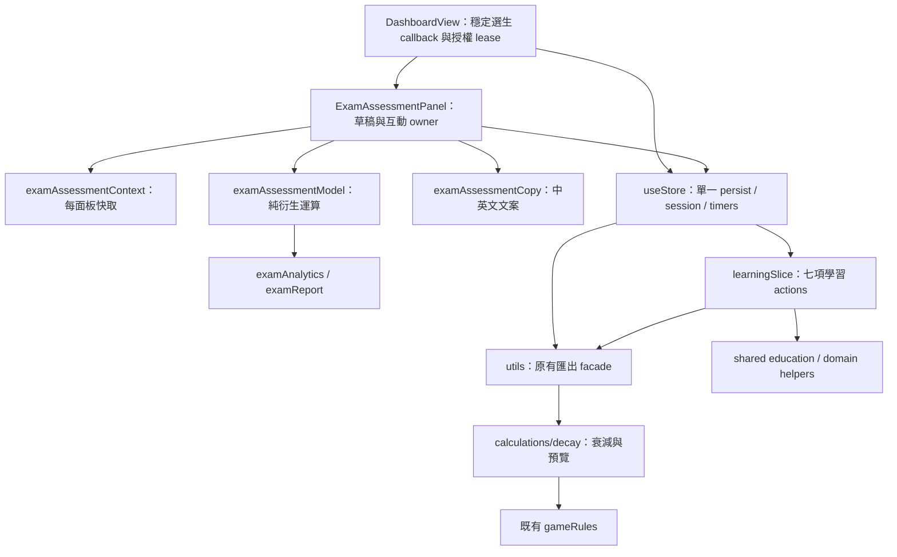

# ePet 漸進式模組化計畫

> 發布範圍註記（2026-11-17）：本文件的「未 push／未部署」描述原任務驗收當時狀態。使用者後續另行授權推送 GitHub main；推送與自動部署結果以 GitHub commit／Actions 記錄為準。本機驗收不等同正式部署驗證。

規劃日期：2026-11-15；續作與驗收日期：2026-11-17。基底：`422ca70cf9206e6b7880d30f700c3e2811ecd149` 加上工作目錄中已完成但未提交的 Learning／遊戲入口修改。本輪不部署、不改持久化格式、不執行 migration。

## 評估

| 檔案 | 起始行數 | 責任與選擇 |
| --- | ---: | --- |
| `src/store/useStore.ts` | 2727 | 混合 root lifecycle、persist、學習、學生、積分與遊戲協調。先抽只依賴 data／toast 的 learningSlice，保留單一 Store |
| `src/store/utils.ts` | 1222 | 混合初始值、legacy normalization、組隊與衰減／設定預覽。先抽同一相依群的衰減與設定預覽，原路徑 re-export |
| `src/features/exams/components/ExamAssessmentPanel.tsx` | 1410 | 文案、Store 訂閱、草稿安全、驗證、資料運算、貼上、報告與大量 JSX。先分離文案／衍生 model／精確 selector，保留互動 owner 及 DOM |
| `server/repository.ts` | 1346 | JSON versions 1–5 相容、序列化寫入、會員、隱私及 history。資料變更必須在單一 mutate queue 內；本輪不以拆檔打斷原子性 |
| `worker/repository.ts` | 2726 | D1 row codecs、投影、CAS／batch、會員與隱私。先抽純 codecs；SQL 排序、gated statements 及 transaction 留在 adapter |

已共用的業務規則包括 `src/domain/game`、`shared/education.ts`、`shared/domain/studentPrivacy.ts`、`repositoryPolicy.ts` 及 bounded workspace validation；不另建第二套規則。

## 本輪依賴順序與小型 PR 邊界

1. **純函式及 adapter 解碼**：utils 的 decay／preview 相依群移入單一模組；D1 row types／decoders 移入專用模組。保留原函式內容、缺省值、Date 行為及匯出。這兩部分互不相依，可獨立審查。
2. **learningSlice**：依賴既有 domain／normalization facade 和獨立的 Store 型別契約。搬移班級校曆、目標、考試、補假、每日評語及學習證據 actions；root 以 spread 組合。每日領取涉及經濟補助，留在 game／root。
3. **考試 context／model**：純文案與資料運算先行，再由元件使用。每個面板建立自己的 roster selector cache，只包含 id／name、class metadata 及 exams；分數、寵物、toast 變更不能無故使此 context 改變。memo 不忽略 callback 或授權；上游學生選擇 callback 需維持正確 class／session 相依。
4. **整體驗證與文件**：原有介面、資料、範圍、匯入／還原、Revision／Autosave、分析事件及 PDF／CSV 回歸。測試結果另附，不將計畫視為已完成驗證。

本工作目錄包含前兩項功能任務的未提交修改。以上是可獨立審查的 PR／提交邊界；不把整個工作目錄混成一個重構 PR，也不在本輪自行 push、merge 或發布。

## 必須保持的不變量

- 對外 `useStore` actions 名稱、參數及回傳型別不變；只保留一個 root `persist`、storage key、partialize、skipHydration 與 merge。
- Autosave 依賴 `data` reference。無效／封存／缺少對象的操作維持 no-op reference；toast、timers 不能 clone data；有效操作保留未修改班級的 references。
- session generation、權限降級與 reset／timer ownership 留在 root，不讓 slice 自行重設 session 或持久化暫存 UI。
- 考試 workflow 開始與完成、analytics 的執行順序不變，事件不放進 updater，也不對失敗寫入上報完成。
- 每日評語 evidence 保留 immutable revision history；Student ID 仍須帶班級範圍，不能跨班更新。
- Node 的 queued mutate／atomic rename 與 D1 的 CAS／write token gated batch 不改成泛用 read-then-write；codec 不新增查詢或寫入。
- 考試運算沿用 `examAnalytics`／`examReport`。面板原本 trim＋locale lowercase 的重複題名檢查，與 canonical normalization 的內部空白規則不同，這輪不擅自統一或改變可接受資料。
- 不更動資料庫、序列化語意、歷史保存、RBAC、CSRF、Tenant Isolation 與 Revision Conflict 回應政策。

## 後續 PR 條件

| 候選 | 尚未直接拆分的原因 | 先決條件 |
| --- | --- | --- |
| classSlice | 切班同時清理 transient 狀態，建班含 onboarding／analytics | 先固定 class switching／session cleanup 的 characterization tests |
| studentSlice | 刪除會連動 evidence、exams、privacy history 與同 ID 跨班保護 | 完整 composite identity／privacy 契約測試，避免只搬 CRUD 名稱 |
| gameSlice | RNG、economy、undo、動畫 timer、boss async 都有跨域相依 | 依單一事件族分批抽出，保留外部效果 owner；不一次搬所有遊戲 |
| settings canonicalization | root updater 與 import normalizer 有重複，但 normalize 全 workspace 會改學生歷史與 references | 先抽可比較的 settings-only 契約，獨立驗證 legacy／輸入政策 |
| Node auth／loadFromFile | 同一 atomic mutation 與 versions 1–5 轉換有安全依賴 | 先補各 legacy format 的契約，不能為縮短檔案拆散 transaction |
| D1 projection／serialization | active 與 retained history 的 bounds 不同 | 分別維持契約；不要將兩條序列化路徑合成較寬鬆的驗證 |
| 考試表格／報告 JSX | 現有焦點、鍵盤格位與草稿生命周期需要單一 owner | 先固定 context／model 契約，再按可獨立測試的展示區塊拆分；避免巨型 controller hook |
| D1 測試 migration helper | 多個 parity suites 重複 trigger-aware splitter | 以 explicit migration list 共用；不能把刻意測 incremental migrations 的 d1-core 改成套用全部 |

`normalizeClassIds` 在 Auth 與 Repository 的 trim／上限／排序不同，不是可直接替換的重複。Node／D1 revision list 的 default／non-finite limit、audit 次序也須先 characterization，再另行決定是否統一；本輪不改既有語意。

## 驗收與實作紀錄

狀態：**Completed（本輪重構與本機自動化驗收）**，驗收日期 2026-11-17。後續 class／student／game slices、Node legacy loader 或完整 Repository 拆分仍依前述條件分批評估，沒有宣稱全專案技術債已清除。

### 已完成的模組邊界

| 入口檔案 | 起始 → 重構後行數 | 本輪變更及新增檔案 |
| --- | --- | --- |
| `src/store/useStore.ts` | 2727 → 2297 | `storeTypes.ts`（155 行）及 `slices/learningSlice.ts`（302 行）；action public surface 不變 |
| `src/store/utils.ts` | 1222 → 1061 | `calculations/decay.ts`（167 行）；原函式與 `SettingsImpactPreview` 型別由 facade re-export |
| `src/features/exams/components/ExamAssessmentPanel.tsx` | 1410 → 1187 | `model/examAssessmentCopy.ts`（181）、`examAssessmentContext.ts`（40）、`examAssessmentModel.ts`（59） |
| `worker/repository.ts` | 2726 → 2533 | `worker/repositoryRows.ts`（209 行），保留原 Repository 公開 options／report 型別 |
| `server/repository.ts` | 1346 → 1346 | 評估後保留，沒有為行數變化搬動 JSON legacy 轉換或 atomic mutate |

另調整 `src/components/DashboardView.tsx` 的選生 callback／props 穩定性；`package.json` 僅註冊新增測試，沒有依賴或 lockfile 變更。

`tests/e2e/product-analytics.spec.ts` 的合成命令測試明確由 Owner 啟用其需要的魔王入口；不再假設新客戶所有遊戲入口預設開啟。只修正 fixture，保留事件數量、ACK、匿名 payload 及 DNT 斷言。

新增契約測試：`tests/storeCalculations.test.ts`、`learningSlice.test.ts`、`examAssessmentContext.test.ts`、`examAssessmentModel.test.ts`、`repositoryRows.test.ts`。共 34 項，涵蓋原函式 facade、calendar／archive／reference、scope、immutable history、事件順序、selector 失效、報告及 row nullability。

Repository 保持 `D1WorkspaceRepository → repositoryRows`，codecs 只解析 rows，不依賴 Repository instance；Node／D1 仍共用既有 repositoryPolicy、studentPrivacy 與 validation。沒有新增基底 Repository、transaction wrapper 或新的 persistence owner。

`storeTypes.ts` 全部是 type-only 相依；`learningSlice → utils → calculations/domain` 的 runtime graph 不會回到 `useStore`。獨立審查以 TypeScript 消除 type imports 後追蹤 36 個模組，未發現新增循環。

### 訂閱與安全邊界

- `createExamAssessmentContextSelector()` 為每個 Panel 建立 cache，讀取 class id/name、Student id/name 及 examRecords，不包含點數、寵物、評語或學習證據。遊戲／點數／無關班級變動重用 context／roster references；學生改名、重排、增刪、考試及班級變動正確失效。
- session generation 改變或 class 缺失會清空快取。不同 Panel 不共用資料，即使 Student ID 同為 100 也不跨班復用。
- `React.memo` 使用預設 comparator，沒有忽略 callback、readOnly、visible、classId 或 reportRequestId。上游選生 callback 依賴 class、generation 及實際 draft lease；lease 撤銷／恢復會喚醒 memoized editor，不因相同名冊而沿用失效的 permit。
- callback 執行時重新確認當前 generation 及最新 Store 的班級／學生歸屬，沒有固定住舊的 class closure。lease 不傳往畫面、儲存或分析。
- 維護性測試驗證 reference 與失效條件；未執行 React Profiler／生產效能量測，不宣稱降低了特定百分比的 render 或延遲。

### 實際測試結果

| 命令／範圍 | 通過 | 失敗／略過 | 證據 |
| --- | ---: | --- | --- |
| `npx tsx --test tests/storeCalculations.test.ts` | 5 | 0／0 | facade 同一函式、local calendar、archive、no-op、升級成本預覽及 no mutation |
| `npx tsx --test tests/learningSlice.test.ts tests/analyticsStore.test.ts tests/productWorkflowLifecycle.test.ts tests/classArchiveStore.test.ts` | 79 | 0／0 | 真實 root Store，含 9 項新 characterization cases |
| `npx tsx --test tests/examAssessmentContext.test.ts tests/examAssessmentModel.test.ts tests/examDraft.test.ts` | 15 | 0／0 | 含 12 項新測試；selector identity、session reset、同 ID 跨班、零分、未填、報告選取與語意維持 |
| `npx tsx --test tests/repositoryRows.test.ts tests/d1-core.test.ts` | 31 | 0／0 | codecs 8＋本機合成 Miniflare D1 core 23；CAS、projection、privacy rollback、history 及容量 |
| `npm run test:rules` | 94 個既有規則檢查＋2 項 Node 測試 | 0／0 | Game domain facade／循環相依檢查 |
| `npm run verify` | **889** | **0／0** | 795 項 Node 測試＋94 項既有規則檢查；8 個 migration checksum、typecheck、build、分析建置隔離、Worker dry-run 成功 |
| `npm run lint`（最終來源） | exit 0 | 0 | 含修正後產品分析 fixture |
| 五個新測試檔合併執行、`npx tsc --noEmit`（最終 patch 格式整理後） | 34／exit 0 | 0／0 | 僅清除新 type-only 檔的空白，不改 runtime；型別及模組契約重驗 |
| 逐檔 `EPET_CI_KIND=e2e EPET_CI_SPEC=<spec> node scripts/release-ci.mjs browser` | **73** | **0／0** | 10 個 spec，見下表 |
| 同上，`EPET_CI_KIND=a11y` | **21** | **0／0** | pages 9、dialogs 4、keyboard 2、class-lifecycle 4、privacy 2 |
| 同上，`EPET_CI_KIND=capacity` | **9** | **0／0** | 合成 D1 真實 413／409、Retry-After、有界重試、草稿與權限隔離 |

分批測試與新增 34 項契約均已納入 verify，不能把重跑次數累加當成獨立測試數。環境變數表示法在 PowerShell 以 `$env:EPET_CI_KIND`／`$env:EPET_CI_SPEC` 設定。所有瀏覽器 spec 依序執行，不調高正式 rate limit。

| E2E spec（`tests/e2e/`） | 通過 |
| --- | ---: |
| `learning-workflow.spec.ts` | 10 |
| `exam.spec.ts` | 1 |
| `teacher-console-navigation.spec.ts` | 15 |
| `game-features.spec.ts` | 8 |
| `draft-recovery.spec.ts` | 10 |
| `conflict-recovery.spec.ts` | 8 |
| `data-safety.spec.ts` | 6 |
| `permissions.spec.ts` | 2 |
| `class-lifecycle.spec.ts` | 6 |
| `product-analytics.spec.ts`（修正 fixture 後完整重跑） | 7 |

整合時產品分析初次為 6 passed／1 failed，卡在簡約方案未顯示的魔王入口。明確啟用該合成測試所需入口後，完整重跑 7/7 通過；沒有移除案例、改變產品預設或降低任何事件／隱私斷言。分批新增 fixture 的型別與 canonical event stage 名稱亦依既有契約修正，未修改實作以迎合錯誤預期。

無障礙沿用既有 axe 規則及 critical／serious gate，未關閉規則；這不是完整 WCAG／螢幕閱讀器認證。真機觸控、實際 OS PDF 列印及生產效能 profiling 不在已完成驗證之列。

### 搬移比對與小型 PR 交付

- `check-learning-extraction.mjs`：七個 action bodies、mentor evidence helper 及 root types 與本輪前基線一致，只忽略縮排／type export。
- `check-moves.mjs`：9 個機械比對通過，包括 decay／preview、6 個 D1 decoders、完整 D1 class 及完整 Node Repository。SQL、CAS、write-token、batch 順序、checksum 與序列化內容保持不變。
- 既有 `src/App.tsx` 與 `src/hooks/useBackendSync.ts` 與前一任務驗收 hash 一致；先前已完成的 Learning／遊戲修改保留。
- `git diff --check` 通過。
- 四份 patch 在 `output/refactoring/review-patches/`，依 01 decay → 02 learning → 03 exam → 04 D1 套用，分別包含必要測試註冊；第四批附本文件。已在隔離的 output 目錄逐份執行 `git apply --check` 與套用，結果重建目前對應來源檔案。
- **Patch 基線是本輪開始前已驗收的功能工作目錄，不是裸 main**。正式建立 PR 前，先獨立提交／整合先前 Learning 與遊戲功能，再依序建立這四個小型 PR，各自接受 CI 與 review。隔離套用檢查不等於四個遠端 PR 已跑過 GitHub CI。

原始與最終證據在忽略追蹤的 `output/refactoring/`：`verify.log`／`verify-exit.txt`、`learning-acceptance.log`、`repository-tests.log`、`calculations.log`、`leaf-modules.log`、`final-*.log`、`acceptance-product-analytics.log`、`acceptance-summary.json`、`mechanical-proof.json` 及 review-patches manifest／application proof。summary 保留初次瀏覽器結果及最後重跑來源。

### 發布影響與剩餘風險

沒有 SQL Migration、Secrets、Cloudflare 或 GitHub 設定需求；本輪沒有建立 GitHub PR、push、merge、部署或修改正式資料。序列化、Student composite identity、歷史及會員資料均沿用原格式。

後續 PR 應優先補齊 Node legacy loader 及 Repository 極端 limit／非 ASCII audit 排序的明確契約，再決定是否統一；不能藉模組化順便改變原有行為。class／student／game slices 與考試大型 JSX 的下一階段拆分，依維護成本與實測需求進行。
