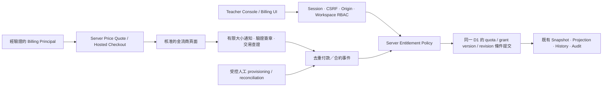

# ePet 商業化 SaaS：需求、定價與交付計畫

日期：2026-11-25。對象：台灣個人教師、單校小型補習班。檢視基準：本機 `7c7f9a9` 與目前既有前端修改；不是正式環境設定或客戶使用情形的查核。

**本次完成需求／架構提案，不實作金流。實際客戶需求、價格、方案容量與付費意願尚未驗證；目前不核准金流開發或公開付費上線。** 沒有提供／使用真實支付憑證、信用卡或學生資料，也沒有修改 Production 訂閱、會員、D1、Secrets 或 Worker。

## 1. 結論與證據分級

建議先採「每個 Workspace 一份合約、邀請制、14 天無卡試用、人工協助導入」，取得 1–3 家真實使用與付款決策者證據後，再選一家本地 hosted recurring provider。首版收軟體服務費，不替補習班代收學費、不販售遊戲積分、不提供學生／家長獨立帳戶。

| 分級 | 本次掌握的內容 | 能支持的決策 |
| --- | --- | --- |
| 已確認程式能力 | Workspace、session／RBAC／限班、邀請、owner transfer、資料匯出／刪除、revision、封存、Today onboarding、隱私優先分析已存在。 | 沿用這些能力，新增商業權益邊界；不重建登入、名冊、分析或另一套 onboarding。 |
| 已確認缺口 | 本機 routes／repository／migrations 未見 subscription、price catalog、商業 quota、checkout、付款 webhook、Billing UI、客服案件生命週期。 | B01／B04 仍是待實作能力；本計畫不將其標為 Closed。 |
| 官方文件證據 | 本地支付商的產品規格／申請條件、Stripe 支援地區、D1 限制可查證。 | 支援供應商 shortlist，不能等同 ePet 已通過商戶審查、已拿到報價或完成串接。 |
| 尚未取得客戶證據 | 未收到可核實的訪談、試點承諾、預算、班級負載或付款決策紀錄。Repository 與可見 GitHub issues 的「試點」「billing」定向查詢未提供需求證據。 | 價格、人數、試用期均為假設。已提供證據數為 0，不代表實際市場沒有客戶或已拒絕產品。 |
| 外部營運待查 | 商戶法律主體、金流資格、發票、DPA、客服／值班、寄信與告警、真正隔離 staging。 | 需管理員／營運驗收；不能以文件或本機測試替代。 |

來源：`server/api.ts`、`server/routes/`、`server/auth.ts`、`migrations/0002_auth_rbac.sql`／`0008_product_onboarding.sql`、[既有商業稽核 B01–B05](commercial-readiness-audit.md)、[分析試點契約](product-analytics-pilot.md)。可核對的需求帳本及訪談題見 [封閉試點驗證方案](closed-pilot-validation-plan.md)。

## 2. 商業單位與候選價格

計費單位是 **Workspace／月**，不是學生帳號、API 呼叫或遊戲積分。一名教師可加入不同補習班的 Workspace，各自依該 Workspace 合約計算席次，不跨校合併配額。MVP 不新增 organization／跨分校共享訂閱。

下表只用於訪談與無付款 prototype。價格以新台幣每月總價作為研究錨點；適用稅費、發票、供應商成本與正式含稅標示需核定後才能公開。先問現有行為、成本與預算，再展示價格，避免把禮貌回應當作願意付費。

| 候選方案 | 價格／期間假設 | 可寫入成員 | 使用中名冊名額 | Workspace／功能 |
| --- | --- | ---: | ---: | --- |
| Guided Trial | NT$0、明確啟動後 14 天；不綁卡、不自動轉付費 | 1 | 30 | 一個受控試用 Workspace；完整核心教學流程，管理員決定遊戲入口 |
| Teacher | NT$299／月 | 1 | 30 | 一個 Workspace 的合約；核心教學、報告、現有遊戲能力及一般支援 |
| Small School | NT$899／月 | 3 | 100 | 一個 Workspace 的合約；共用名冊、邀請、限班、角色管理，功能不另複製 |
| Expired／取消且已到服務截止日 | 不新增扣款；不是永久免費方案 | 停止一般教學寫入 | 保留既有資料 | 依既有 RBAC 查閱／匯出、必要隱私清理及恢復訂閱 |

**這些不是已可售的容量或正式價目表。** 若 100 人及其合理歷史負載無法通過現有儲存限制，不得販售這項承諾；應先改容量方案或資料架構，再重測。暫不承諾無限班級、無限封存、永久免費、全年歷史容量、年度折扣、分校套餐或自動超額加價。

### 計數契約

- writer = 每個 Workspace 內不同 `userId`、角色為 owner／admin／teacher 的 membership；Owner 也占一席。3 席是 Owner＋另外 2 位，不是「3 位老師外加免費 Owner」。viewer 不具教學寫入權，不能拿來替代學生／家長或共享教師帳號。
- student placement = 使用中班級內一筆 `(workspaceId, classId, studentId)`。同一孩子跨兩班算兩個名冊名額；同 student ID 跨班不能直接去重。目前資料模型不能承諾獨立自然人的去重學生數。
- 封存班級不占使用中名額，但其資料仍占 snapshot／歷史儲存；重新開啟、匯入及 restore 必須重新驗限額。班級數、viewer 數、歷史保留與實際 bytes 一併觀察，核定前不對外說無限。
- 邀請不預留席位；UI 明示接受時再驗。兩人爭最後一席，只能一個接受成功；失敗不得消耗邀請或留下部分 membership／audit。可寫入角色升級、owner transfer 也須檢查淨新增席次。
- 一個 Owner 的自助試用資格需伺服器去重；加入別校不消耗自己的試用。封閉階段以人工核准＋驗證帳號控制濫用，不為防刷試用收身分證、信用卡或裝置指紋。多帳號濫用風險不宣稱已解決。

### 成本與價格驗證

逐 Workspace 量測保存次數、D1 rows read／written、資料與 revision bytes、寄信、支援分鐘、收款／退款／發票費及事故準備金。毛利模型使用實際核准費率，不只看雲端帳單：

`每月貢獻 = 可認列收入 − 適用稅費 − 金流／發票成本 − 分攤雲端／寄信／備份成本 − 支援分鐘×內部每分鐘成本 − 退款／爭議準備`

若 NT$299 客戶每月都要一小時人工支援，低雲端成本也不足以證明方案可持續；應調整導入、價格或目標客群，不能靠降低資料安全或匯出權利補毛利。計費、查詢及 index 的 D1 使用量應依實際 `meta`／監控核對；免費試用不等於平台可以依賴 Cloudflare Free tier 不停機。[D1 官方計價](https://developers.cloudflare.com/d1/platform/pricing/)

## 3. 免費試用與首次導入

1. 招募經確認的教師與付款決策者，先以合成班級展示「名冊 → 記錄學習／加減分 → 已保存 → 報告」。研究同意與學生資料處理約定分開。
2. 沿用邀請／Email 驗證、既有 session 和 RBAC。正式公開註冊仍保持原設定，未驗證 Turnstile／寄信前不切換正式開關。
3. 使用既有註冊預設 Workspace／班級；檢查是否已有可重用空間，明確讓 Owner 選擇試點 Workspace，不為試用重建另一套帳號或重複班級。
4. Owner 看見範圍、日期、資料政策並明確按「開始 14 天試用」。後端檢查資格並一次性寫入 server UTC 起訖與政策版本；重按、重登入或新建空間不能重設期限。此動作目前只是需求設計。
5. 引導新增／匯入名冊、第一次教學操作、重新載入確認保存、查看學生狀態、選擇遊戲介面。沿用現有 Today guide，已完成不強迫重做。
6. 預告到期時間與剩餘容量；提醒日程暫提到期前 7／3／1 日，實際頻率待訪談。支援可申請一次有期限、具理由與 audit 的人工延長，不能讓前端自行延長。
7. 不綁卡，不把試用成功當扣款授權；期滿不自動建立付費合約。Owner 可選擇提出訂閱需求，或依原權限查閱／匯出及退出。

實際啟用前需要權益後端與到期 UX；目前系統沒有這些商業閘門，不得只加一個前端倒數就稱已有試用機制。

## 4. 付款、權益與資料權限架構

細節與 Schema／API 提案見 [Entitlement Architecture](saas-entitlement-architecture.md)。所有方塊中的新增 billing 能力目前均未實作。

- **RBAC 與 entitlement 取交集。** 買方案不會把 teacher 變 admin、讓 viewer 寫入或擴大 Class Scope；owner/admin 的管理權也不代表可以自行設定「已付款」。
- Billing catalog、grant、付款／發票與 usage 不放進可匯入、可還原的 AppData。`gameFeatures` 只是既有 UI 可用性，不作商業授權來源。前端 cache 僅作顯示，不能信任 `isPaid`、本機日期或 redirect success。
- 伺服器在所有命令入口檢查，包括註冊預設空間／新增 Workspace、State PUT、邀請接受、角色變更、owner transfer、學生新增、批次匯入、重新開班、完整匯入／revision restore。不能只擋 UI 或單一學生 API。
- 配額判斷、membership／資料更新、projection、history、業務 audit 必須具同一不可分割成功條件。D1 batch 不能在首個 CAS 失敗後仍留下後續 audit；Node JSON adapter 也須在其既有序列化區內做等價判斷。具體原子化方法必須先以合成競爭測試驗證，不以 read-then-write 宣稱完成。
- quota_reached（目前剛好等於上限）仍可記錄既有學生；超額的 proposed write 僅拒絕該次操作，不能把已合法 Workspace 鎖成 over_limit。已提交資料確實超新方案上限才進入受限狀態。
- 商業 grant version 與教學 Workspace revision 分開；續費通知不製造假教學 revision。寫入時同時防護 grant／用量競爭與既有 revision，不移除 CAS。
- Owner／admin 可看經核准的全 Workspace 用量；限班教師只得到自己的操作是否可用與「聯絡管理員」提示，不藉 quota error 揭露 B 班名冊、整體 bytes 或明細。

### 容量是商業發布閘門

目前 ePet 自訂 snapshot 上限 **900 KiB**、保留 **25 份 revisions**（`shared/domain/repositoryPolicy.ts`）；一般 HTTP body **2 MiB**、auth body **16 KiB**（`server/http/body.ts`）。validation 的 200 班／每班 500／總計 5,000 只是輸入防濫用界線，不代表支援或方案容量。

Cloudflare 官方目前列 D1 單一 string／BLOB／row 上限 2,000,000 bytes；這不會自動提高 ePet 的 900 KiB 安全界線。購買較高方案不能突破應用限制；不得直接調大限制或刪歷史以履行價格表。[D1 官方限制](https://developers.cloudflare.com/d1/platform/limits/)

正式承諾前需以候選 30／100 人次、合理重複上課、至少一學期的合成考試／證據／回饋、封存、25 revisions、並行教師、匯出／復原及刪除回放測試。提議 current snapshot 預留至少 30% headroom 作門檻，這個比例也是待核准的工程預算，不是現有保證。不能通過就調整方案或另立保存架構專案；不可把曾測過 300 人空／少歷史名冊當成 100 人一學期容量證據。

## 5. 到期、取消、重新啟用與資料存取

| 情況 | 付款／權益 | 教學與資料存取 |
| --- | --- | --- |
| 有效試用／已確認 active | 在已核定範圍寫入 | 既有 RBAC／Class Scope，配額內正常教學 |
| pending checkout／provider 暫時不可用 | 不因此擴權，也不抹除尚有效的已確認 grant | 依既有 grant 及截止時間運作；不能把未知狀態直接當已付款或讓快取無限有效 |
| 續費失敗 | 候選 7 天 past-due grace；沿用最後合法、有界 grant | 明確提醒、可重試合法付款；到 graceUntil 後唯讀。Cron 遺漏不能延長期限，伺服器逐次檢查時間 |
| 已取消續約 | `cancel_at_period_end`，仍服務到已付截止日 | 截止前不提前鎖定或刪資料；之後依原權限唯讀／匯出／必要清理 |
| 試用到期或 grace 結束 | 不建立新扣款 | 停止一般教學 State PUT／import／restore；保留有權者讀取與原有角色允許的匯出 |
| 真正 over_limit | 不刪名冊、不移除會員、不自動升級或收更高價 | 受限查閱、原權限匯出、明確 archive／隱私刪除／成員降權移除等清理命令 |
| 重新啟用 | 先確認新合約、用量適配及 server verified payment／manual grant | 解鎖同一 Workspace 的既有資料；不建立副本或重設試用，不覆寫雲端 revision |

隱私刪除、取消未來扣款與退出不能綁在付費升級上。archive／delete 走現有明確權限與確認流程；不能以「payload 變小」就允許任意 State PUT 繞過唯讀。唯讀只因訂閱限制，不恢復已遭撤權／停權帳號的登入或資料權限。

**訂閱過期不觸發學生資料刪除，也不新增一個隱藏的 N 天到期刪庫 Cron。** 保留／備份／法定義務與資料主體請求另依核定政策，學校與 ePet 的責任先約定；未核定前不承諾永久無限保存或到期自動清空。應用 revision restore 與災難復原仍遵循現有個資刪除回放；不能復活被刪資料或把舊付費狀態還原為有效。

### 避免教師卡死或遺失草稿

新增商業拒絕碼（例如 `PLAN_WRITE_RESTRICTED`）必須是可預測的 terminal error，不當網路錯誤無限 retry。不可把它當 session 失效清掉草稿。先告知「未保存的本機修改仍待處理」，沿用身分／Workspace／Class Scope 驗證、合法重新同步或採用遠端的明確確認。

現有未同步草稿 TTL 為 24 小時、下載亦有角色限制，不能因有這個機制就承諾可保存到 14 天試用結束後。實作前須驗收：到期前提示 pending writes；到期中維持 draft 安全提示、支援範圍正確的恢復／資料救援；不擅自給限班教師整包 Workspace 下載、不自動覆寫遠端或無條件寬放 State PUT。

### 取消與責任交接

- MVP 月繳，取消未來續約，不實作自動按日比例、年繳、優惠券、隱藏 overage 或自動 downgrade。低方案需用量符合才核准生效；不符合時明示處理選項，仍可取消，不偷續扣較高方案。
- 退款、取消續約、資料刪除是三件獨立事；退款／爭議依確認的商業與法律政策處理，不以退款直接回滾學生教學資料。
- 工作區 Owner 移轉不等於付款人變更。既有客戶／扣款授權／過往發票不自動交給新 Owner；新付款責任須明確同意。原付款人取消自己未來扣款的權利，與是否仍可讀學生資料分開設計。
- 若 provider 不支援撤銷後恢復原定扣款，重新啟用要新的 hosted 同意／合約，先確認舊合約不會重複扣款。帳號／Workspace 刪除則另辦取消與財務最小保留；provider 故障不能無限期阻擋必要隱私處理。

## 6. Billing UI 與收款方式

Owner 的「管理設定 → 方案與帳務」首版只需要以下資訊，不再做一套教學 Dashboard：

| 區域 | 顯示／操作 | 後端權限 |
| --- | --- | --- |
| 目前方案 | trial／active／grace／唯讀、台北時間顯示截止日、取消續約狀態 | Owner；admin 可看不含付款個資的方案／用量摘要 |
| 用量 | writers（含 Owner）、使用中名冊名額、封存資料仍占容量、接近限制說明 | 全 Workspace 用量僅 Owner／核准 admin；teacher 不取得越班明細 |
| 合約與價格 | 每期總價、幣別／稅務標示、下一期日期、政策版本及是否自動續約 | server quote，不能接收前端自行指定 amount／status |
| 訂閱動作 | 提出試用延長、變更需求、取消續約、重新啟用 | 經驗證 billing principal；session、CSRF、Origin、權限、必要再認證 |
| 收據／發票／退款 | 供應商或合法財務文件的受限連結、狀態與支援入口 | 不因是 Workspace admin 就提供原付款人全部歷史個資 |
| 問題回報 | 固定分類、request ID、時間、同步狀態，明示不要填學生或信用卡資料 | 受控支援流程，不取得 Cookie／Token／request body |

帳務服務 timeout 或交易結果未知時顯示「付款狀態確認中，請勿重複操作」，先查詢對帳，不預設已付費或未扣款。只有伺服器確定未建立／送出交易時，才能顯示「尚未送出扣款」。取消流程要列最後服務時間、取消的是下一期、資料仍保留；不得把工作區永久刪除做成取消付款的附帶勾選。

付款採 **供應商網域的 hosted redirect**。ePet 不收／存 PAN、CVV、有效期，不提供可輸入卡號的原生表單，也不讓學生資料、成績、班級名稱進入 payment description／metadata；MVP 不保存卡末四碼。Opaque recurring reference／金流密鑰即使不是卡號仍是敏感憑證，僅限後端並依供應商契約最小化保存。TWD 金額必須明訂單位與整數轉換，不能把「299 元」傳成「299 分」。

### Billing Provider 建議

完整官方查證與未確認項目見 [Billing Provider 比較](billing-provider-comparison.md)。目前 shortlist 是綠界與藍新的 hosted recurring 類型；先取得合適商戶資格、當期規格、報價及實際 sandbox 結果再決定，不同時串兩家。TapPay 的 embedded SDK tokenization／Link Pay 不能直接視為同一套 hosted 訂閱服務；Stripe 不能當台灣本地法律主體的預設選項。

下列是擇一條件，不是現已選定供應商：

1. 台灣營運主體能核准商戶與定期扣款，提供 TWD 結算及透明固定／變動費。
2. 信用卡資料留在供應商頁面，正式週期、失敗重試、取消、重新授權及退款語意均有可取得的文件。
3. signed notification／查詢能支援冪等對帳，價格／商戶／訂單／幣別／Workspace binding 可在後端核實。redirect 不是付款證據。
4. 可提供適當發票方案與退款／折讓流程；支付收據不自動代表台灣法定發票義務完成。ePet 是軟體服務銷售方，不能因客戶是補習班就自行套用教育勞務待遇；營運主體與稅務適用需正式確認。[統一發票使用辦法](https://law.moj.gov.tw/LawClass/LawAll.aspx?PCode=G0340082)
5. 以當期規格與合約核實 sandbox 能測／不能測項目，列出需要正式核准後人工驗證的項目。本次不執行真實扣款。

## 7. MVP 與資料庫變更範圍

| 優先 | 商業能力 | 驗收標準 |
| --- | --- | --- |
| P0：試點前 | 需求證據、真正隔離 staging、資料處理／支援 owner、容量及恢復驗收、試用／退出政策 | 具來源／日期／負責人的證據；不使用真學生資料驗證基礎設施，不以現有文件當外部設定已完成 |
| P0：非金流 MVP | server entitlement、受控 manual provisioning、席次／名冊／容量查詢、到期與 draft UX | Node／D1 競爭測試、所有寫入路徑、Class Scope、expired／reached／overlimit、舊資料相容均通過 |
| P0：商業營運 | 沿用 Today onboarding、支援案件編號／分類／接手、資料退出與安全通報 | 不重建 onboarding，不做客服 impersonation；報告不能附學生資料或憑證 |
| P1：需求證據 gate 後 | 擇一 provider sandbox、Owner Billing UI、verified webhook／reconciliation、取消／重新啟用、發票／退款狀態 | 重放／亂序／重複 checkout／失敗補償／兩人爭席／權限變更／本機 draft 不遺失等可重複驗收 |
| P1：收費前 | 商戶／發票／退款條款、正式環境核准、Secrets least privilege、成本及對帳接手 | 獨立營運簽核與核准的切換／回復演練；本次尚未執行 |
| P2：有證據再做 | 自助公開註冊、年繳／按比例變更、跨分校組織、SSO/MFA、學生／家長獨立入口 | 另行需求與安全設計；不綁進第一次付費 MVP |

Schema 只做規劃，**本次沒有新增或執行 migration**：

- Expand：版本化方案／價格、Workspace grant／subscription、必要 usage counters、操作／付款去重 ledger、最小 billing principal／財務 references；先列 purpose、FK／unique、保留及存取，和 AppData 分離。
- Migrate：合成 Node／D1 先驗證；盤點既有 Workspace 與角色／名冊／容量，為已識別 legacy cohort 發可稽核、有期限、符合現用量的過渡 grant，不能把缺資料猜成新免費／過期／已付費，也不能直接縮容、刪除或合併。
- Enforce：shadow comparison → 已同意的試點 Workspace → 明確通知後分批開啟；任何 count／projection／CAS 不一致先停 rollout，已確認權益不可從客戶 snapshot 重建。
- Contract：足夠穩定與正式核准後才考慮收斂暫存；本版不刪舊欄位／舊 snapshot。回復應停 checkout／續約變更、保留對帳及 read/export/privacy rights；不得靠 D1 rollback 撤回真實付款或復活已刪學生。

具體 tables／索引／adapter／故障語意及合成測試矩陣由 [Entitlement Architecture](saas-entitlement-architecture.md) 定義。完整 financial record 不應因 Workspace／帳號刪除直接 cascade 消失，也不能藉財務保存無限保留教育資料；最小化 references 與核定保留另行處理。

## 8. 分階段實作與 1–3 家試點

| 階段 | 工作 | 進入下一階段的證據 |
| --- | --- | --- |
| S0：本次設計 | 現況盤點、候選價格與政策、架構、provider shortlist、研究方案 | 文件可審查；不等同客戶證據或功能交付 |
| S1：需求探索 | 1–3 家目標機構／個人教師、教學者與付款決策者訪談；先合成展示，再取得研究同意 | 至少一份可追溯完整需求、角色／人次定義、真實近期流程與付款決策路徑；未知項維持 UNKNOWN |
| S2：無金流試點底座 | 合成容量／災難復原／權限驗證，manual grant、用量／到期／支援 prototype；核定條款與責任 | 實際 hosted 隔離與資料保護門檻通過，才讓受邀者用合法取得的資料；先一家，安全穩定再增至三家 |
| S3：封閉價值驗證 | 14 天無卡，至少兩個獨立教學日的核心流程、真保存與重登入、支援分鐘／退出與價格研究 | 逐家事實、失敗／反例、容量與成本、真正付款者具體下一步；小 N 不宣稱市場轉換率 |
| S4：擇一金流實作 | 只有需求與付費路徑通過後，另核准 sandbox adapter、ledger／對帳與 Billing UI | 商戶條件可滿足；所有退款／取消／重放與故障案例有證據，營運可接手 |
| S5：受控收費 | 正式規格／稅務／資安／營運簽核後，另取得明確正式環境授權 | 人工核准的切換及回復，單一試點對帳確認後再擴大；不是本次執行範圍 |

時程以 [六週試點範本](closed-pilot-validation-plan.md) 作研究安排，工程迭代與商戶審查時間另估，不承諾固定上市日期。單一學校有價值可支持該情境繼續驗證，不代表台灣市場成立；公開方案至少再取得獨立機構的交叉證據與可持續成本。

### 本次 go／no-go

- 可進行：審查設計、招募與訪談、合成工作流程與容量測試規劃、支援責任指派。
- 未滿足：實際需求／付款意願／方案容量證據、商戶核准與稅務／營運設定。
- **No-go：實際金流程式、真實支付憑證、公開自助收費及 Production 商業資料變更。** 尚未取得的訪談、同意、角色／人次與價格決策不能用技術測試補造。

## 9. 本次驗證與限制

本次只新增設計文件，沿用並保留既有未提交的前端修改。檢查文件連結、需求覆蓋與用語一致性；沒有執行金流 sandbox、真交易、SQL migration、正式帳號／訂閱調整或實客試點。既有功能的歷史測試不能引用為尚未實作 billing／quota 的通過證據。

2026-11-25 文件驗證：4 份新文件的 15 個本地 Markdown 連結、30 個不同來源檔引用（含起始行號界線）、編碼、尾端空白與 code fences 檢查均通過，錯誤 0；`git diff --check` 通過（Git 的 CRLF 提示不是檢查失敗）。獨立交叉複核發現的取消截止日／事件去重鍵差異已修正，付款 timeout 亦不再誤稱未扣款。驗證紀錄位於本機 ignored `output/saas-commercialization/validation-20261125.json`。本次未重跑 `npm run verify` 或 E2E：沒有新執行邏輯，這些測試也不能證明尚未實作的商業權益或真實試點。

工程及商業能力狀態：需求／架構文件可完成；B01／B04 實作、B05 外部營運與正式發布門檻仍未完成。本文件不替它們作 Closed 判定。
